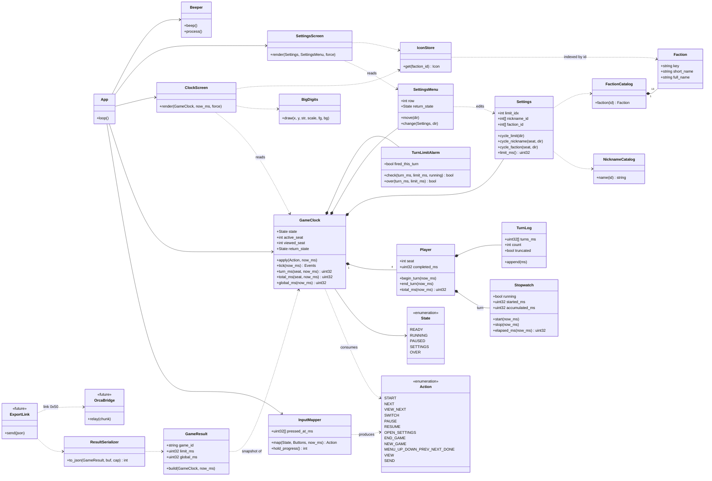
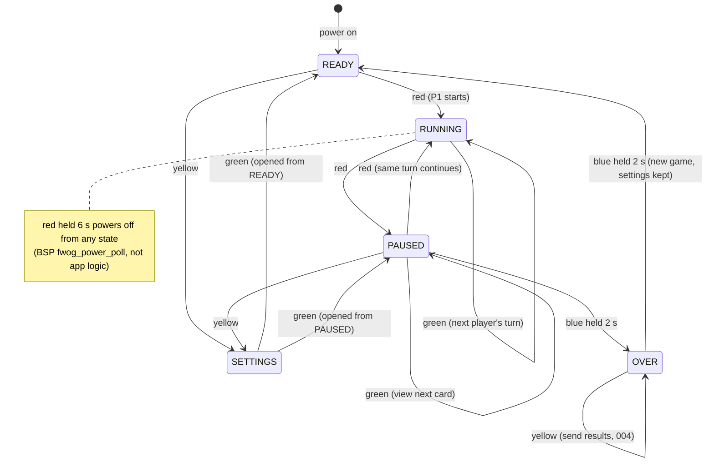

# 03 — Object model: rootclock

The firmware is C, so each "class" here is a struct plus the functions that take a pointer to
it. All of these use an `rc_` prefix, for example `rc_game_t` and `rc_game_apply()`. They fall
into three groups:

- **Model** (`core/`): pure C with **no Pico SDK includes**. Time arrives as a `now_ms`
  argument, and buttons arrive as a plain bitmask struct. That keeps all of it testable on a
  PC.
- **View / device** (`display/`): draws to the LCD and plays sound through the BSP.
- **Future** (`<<future>>`): placeholders for the export path in
  [04](04-future-esp32-integration.md), designed now and built later.

## Proposed layout

```
apps/rootclock/
  CMakeLists.txt            rootclock_display then rootclock_main
  README.md                 button map + acceptance script
  core/                     MODEL - SDK-free, host-testable
    rc_types.h              shared enums/constants: rc_state_t, rc_action_t, rc_buttons_t, rc_faction_id_t
    rc_stopwatch.{h,c}
    rc_player.{h,c}         Player + TurnLog
    rc_catalog.{h,c}        nickname + faction tables
    rc_settings.{h,c}       Settings + SettingsMenu
    rc_alarm.{h,c}          TurnLimitAlarm
    rc_input.{h,c}          InputMapper (press edges, 2 s holds -> actions)
    rc_game.{h,c}           GameClock state machine
    rc_result.{h,c}         GameResult snapshot + JSON serializer
  display/                  VIEW / DEVICE - uses the BSP
    main.c                  the loop
    ui_palette.h
    ui_bigdigits.{h,c}
    ui_clock.{h,c}          S1
    ui_settings.{h,c}       S2
    beeper.{h,c}
    assets/faction_icons.{h,c}   GENERATED, checked in
  main/main.c               template main half (watchdog kick + display update)
  assets/factions/<key>.png source icons (moved from "root icons/")
  tools/gen_faction_icons.py
  tests/                    host tests (standalone CMake, needs a host gcc)
```

## Classes

### Model (`core/`)

| Class | C type / module | Responsibility | Key fields | Key operations |
|---|---|---|---|---|
| **GameClock** | `rc_game_t` / `rc_game.c` | Aggregate root. Owns the state machine, the players, the active seat and the global time. Applies actions and reports events. | `state`, `active_seat`, `players[4]`, `settings`, `menu`, `alarm`, `return_state`, `viewed_seat` | `rc_game_init()`, `rc_game_apply(g, action, now)`, `rc_game_tick(g, now)` → events (e.g. `RC_EVT_BEEP`), `rc_game_turn_ms()`, `rc_game_total_ms()`, `rc_game_global_ms()` |
| **Player** | `rc_player_t` / `rc_player.c` | Timing data for one seat. Who the seat *is* (nickname, faction) lives in Settings. | `seat` (1–4), `turn` (Stopwatch), `completed_ms`, `log` (TurnLog) | `rc_player_begin_turn(now)`, `rc_player_end_turn(now)`, `rc_player_pause(now)`, `rc_player_resume(now)`, `rc_player_total_ms(now)`, `rc_player_avg_turn_ms()` (completed turns only) |
| **Stopwatch** | `rc_stopwatch_t` / `rc_stopwatch.c` | Accumulates running time across pauses. | `running`, `started_ms`, `accumulated_ms` | `start(now)`, `stop(now)`, `reset()`, `elapsed_ms(now)` |
| **TurnLog** | `rc_turnlog_t` / `rc_player.c` | Durations of completed turns, oldest first. | `turns_ms[128]`, `count`, `truncated` | `append(ms)`: when full, adds `ms` to the last slot and sets `truncated` |
| **Settings** | `rc_settings_t` / `rc_settings.c` | What the settings page edits. | `players` (3–4), `limit_idx`, `seat[4].nickname_id`, `seat[4].faction_id` | `rc_settings_defaults()`, `cycle_players(dir)`, `players()`, `cycle_limit(dir)`, `cycle_nickname(seat, dir)` (swaps on collision), `cycle_faction(seat, dir)`, `limit_ms()` (0 = off) |
| **SettingsMenu** | `rc_menu_t` / `rc_settings.c` | Cursor state for S2. Kept in the model so it can be tested. | `row` (0–9: PLAYERS, LIMIT, then nickname and faction for P1–P4), `return_state` | `move(dir)`, `change(settings, dir)`, `row_kind(row)`, `row_seat(row)` |
| **NicknameCatalog** | `rc_nicknames[]` / `rc_catalog.c` | The four allowed names. | `{"Jacob","Alex","Ahmed","Lorenzo"}` | `rc_nickname(id)`, `RC_NICKNAME_COUNT` |
| **Faction** / **FactionCatalog** | `rc_faction_t`, `rc_factions[13]` / `rc_catalog.c` | Faction identity. The order is fixed by `rc_faction_id_t` in `rc_types.h`, and is the order of the faction-key table in [04 §2](04-future-esp32-integration.md#faction-keys). | `key` (export id, e.g. `"marquise"`), `short_name` (fits S1), `full_name` | `rc_faction(id)`, `RC_FACTION_COUNT` |
| **TurnLimitAlarm** | `rc_alarm_t` / `rc_alarm.c` | Crossing the limit beeps once per turn; the over-limit state colours the digits. | `fired_this_turn` | `rc_alarm_reset()` at turn start; `rc_alarm_check(turn_ms, limit_ms, running)` → beep once on crossing; `rc_alarm_over(turn_ms, limit_ms)` → red |
| **InputMapper** | `rc_input_t` / `rc_input.c` | Turns button edges into actions for the current state, including the 2 s blue hold. | `pressed_at_ms[5]`, `hold_fired` mask | `rc_input_map(in, state, buttons, now)` → `rc_action_t`; `rc_input_hold_progress()` for the "keep holding..." hint |
| **Action** | `rc_action_t` / `rc_types.h` | What the user asked for, independent of which button. | `kind`, `seat` | kinds: `START`, `NEXT`, `VIEW_NEXT`, `PAUSE`, `RESUME`, `OPEN_SETTINGS`, `END_GAME`, `NEW_GAME`, `MENU_UP`, `MENU_DOWN`, `MENU_PREV`, `MENU_NEXT`, `MENU_DONE`; `SWITCH` and `VIEW` (to a given seat) stay in the API, but since 002 no button emits them |
| **BatteryGauge** | `rc_battery_t` / `rc_battery.c` | *(003)* Charge and time left from charger readings: Li-ion voltage curve, smoothing, drain slope. | `mv_x16` (EMA), history of (`ms`, percent) per minute, `usb`, `charging` | `rc_battery_update(now, mv, usb, charging, full)`, `rc_battery_view()` → mode, percent, minutes left, measured? |
| **GameResult** | `rc_result_t` / `rc_result.c` | Frozen snapshot at game end. This is the export payload's data. | `game_id`, `limit_ms`, `global_ms`, `players[]` of {`seat`, `nickname`, `faction_key`, `total_ms`, `turns_ms[]`, `truncated`}. Only seats with ≥ 1 turn. | `rc_result_build(game, now)` |
| **ResultSerializer** | `rc_result.c` | Writes contract v1 JSON ([04](04-future-esp32-integration.md)). | — | `rc_result_to_json(result, buf, cap)` → length, 0 on overflow |

### View and device (`display/`)

| Class | C type / module | Responsibility | Key fields | Key operations |
|---|---|---|---|---|
| **ClockScreen** | `ui_clock.c` | Draws S1 in every state. Redraws only the fields that changed. | cache of the last drawn strings, colour, seat, state | `ui_clock_render(game, now, force)` |
| **SettingsScreen** | `ui_settings.c` | Draws S2. | cache of the last drawn rows and cursor | `ui_settings_render(settings, menu, force)` |
| **BigDigits** | `ui_bigdigits.c` | Large timer text from `lcd_font_expand()` at scale 6 or 8. | static glyph buffer (48×64 RGB565, 6 KB), last string and colour | `ui_bigdigits_draw(x, y, str, scale, fg, bg)`, which blits only the glyphs that changed |
| **IconStore** | `assets/faction_icons.c` (generated) | 96×96 RGB565 faction icons in flash, indexed by `rc_faction_id_t`. | `const uint16_t px[13][96*96]` | `rc_icon_get(id)` → `{w, h, px}` |
| **Beeper** | `beeper.c` | The time-limit sound. | static 8 kHz sample buffer (~3.2 KB), synthesised once | `beeper_init()` (`i2s_audio_init(pio0, 2)`), `beeper_beep()`, `beeper_process()` (calls `i2s_audio_process()`) |
| **ChargerReader** | `battery.c` | *(003)* Reads BQ25896 status, BATV and VBUSV every 5 s into the BatteryGauge; turns the charger ADC on; never writes a charge setting. | next read time, failure count (backs off after 3) | `battery_init(now)`, `battery_poll(gauge, now)` |
| **App** | `display/main.c` | Owns the loop and wires the parts together. | `rc_game_t`, `rc_input_t` | loop: `fwog_power_poll()` → `rc_input_map()` → `rc_game_apply()` → `rc_game_tick()` → beep → render → `beeper_process()` |

### Upload (004, see [04](04-future-esp32-integration.md))

| Class | Where | Responsibility |
|---|---|---|
| **Uplink** (formats, Outbox, Sender, Reassembler, C6 lines) | `core/rc_uplink.c` | Pure and host-tested: link payloads 0x50–0x53, the display's outbox of up to 4 unsent results, the chunk sender with ACK timeouts, main's reassembly, the `RESULT`/`WIFI` line formats and parser, the GAME OVER text. |
| **ExportLink** | `display/export.c` + `common/rc_link.h` | Keeps finished games in the outbox, asks for WiFi in GAME OVER, sends on yellow, drops a game once main reports it saved on the C6. |
| **OrcaBridge** | `main/bridge.c` (+ `main/main.c` for UART1) | Reassembles chunks, streams them to the ESP32-C6 as `RESULT ...` lines, follows its replies and reports uplink status (0x52). Portable: the simulator runs the same file. |

## Pages → classes

| Page | Reads | Writes (via actions) |
|---|---|---|
| **S1 Player clock** | GameClock (state, active or viewed seat), Player (turn, total, turn count), Settings (nickname, faction, limit), TurnLimitAlarm (red?), IconStore, BigDigits | GameClock: START, NEXT, VIEW_NEXT, PAUSE, RESUME, END_GAME, NEW_GAME |
| **S2 Settings** | Settings, SettingsMenu, NicknameCatalog, FactionCatalog, IconStore | Settings through SettingsMenu: MENU_* actions |
| **Timers** (no page of their own) | Stopwatch, TurnLog, inside Player and GameClock | Only GameClock changes them |

## Class diagram



## State diagram



## Invariants the core tests should check

1. `global_ms == Σ players.total_ms` at every instant. Both come from the same press-edge
   timestamps.
2. For each player, `total_ms == Σ turns_ms + current turn`, including when `truncated` is
   set, because overflow is added into the last slot.
3. Exactly one Stopwatch runs in RUNNING. None runs in READY, PAUSED, SETTINGS or OVER.
4. The nickname ids across the 4 seats are always a permutation of {0, 1, 2, 3}.
5. The alarm fires only while RUNNING, and at most once per turn for a given limit. Raising
   the limit in settings above the current turn's time re-arms it (`rc_alarm_sync`), so the
   turn beeps again when it crosses the new limit.
6. SWITCH to the already-active seat changes nothing. NEXT always moves to a different seat,
   within the first `players` seats (P1 → P2 → P3 (→ P4) → P1).
7. A result contains only seats with `count ≥ 1`, in seat order.
8. VIEW_NEXT changes only `viewed_seat`: no clock starts, stops or changes.
