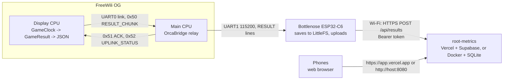
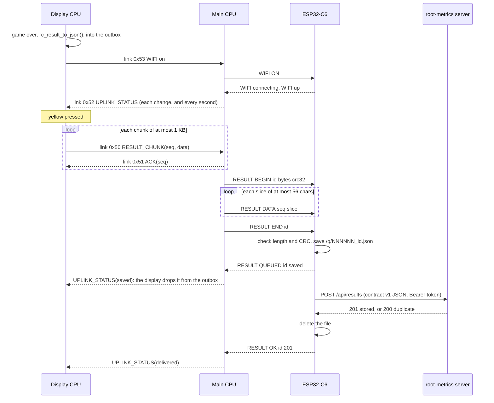

# 04 — Sending results through the ESP32 to the app

**Status: built in rootclock 004** (branch `feat/rootclock-wifi-upload`), not yet run on
hardware. What changed from the first design is marked *(004)*; [§5](#5-what-was-built-004)
lists where each part lives and how it was tested. This page fixes three things so that
neither the firmware nor the app has to guess:

- **the payload contract** (§2), which the MVP already produces on the USB console when a game
  ends (verification hook, [02](02-mvp.md));
- **where each hop lives** (§1), so the MVP's object model has a place to plug the export in;
- **the transport: Wi-Fi HTTP POST** to the root-metrics server (§1, Hop 3). Decided
  2026-11-20, because the receiving app is a web server, not a phone app. *(004)* The server
  can be hosted (Vercel + Supabase, HTTPS) or on the LAN (Docker, HTTP).

**How it works for the players (004).** When the game ends, the board asks the WiFi module to
connect and the GAME OVER screen says how that is going. **Yellow** sends the result. The
display keeps every finished game in a small outbox (4 games) until the WiFi module confirms it
has **saved it to its own flash**; the module then uploads it and retries until the server has
it. So no Bottlenose, no Wi-Fi, a server outage or a power-off never loses a game: it either
stays on the display (yellow tries again) or waits on the module and goes up later. While a
game is being played, the module's radio is off.

Requirement covered: R-EXP-1 (send each player's nickname, faction, total time, and an array
of per-turn times after the game) and R-EXP-2 ([01](01-spec-review.md)).

## 1. Data path





### Hop 1: display → main, over the inter-CPU link (UART0)

The link frames are `[0x7E][len16][payload][crc16]` with a payload of at most 4160 B. Payload
byte 0 is the message type, and app types start at 0x40. The bottlenose app uses 0x40/0x41 in
its own image. The proposed types for rootclock:

| Type | Name | Direction | Payload *(004, `core/rc_uplink.h`)* |
|---|---|---|---|
| 0x50 | `RC_MSG_RESULT_CHUNK` | display → main | `seq` u8, flags u8 (bit 0 = last), up to 1024 bytes of JSON. `seq` 0 starts a result. |
| 0x51 | `RC_MSG_RESULT_ACK` | main → display | `seq` u8, code u8: 0 OK (also for a repeat of the last chunk), 1 bad sequence (start again), 2 too big, 3 busy (main is still handing over the previous result) |
| 0x52 | `RC_MSG_UPLINK_STATUS` | main → display | 14 bytes: C6 alive, Wi-Fi state and why it is down, result state (receiving / to C6 / saved / delivered / rejected / failed) and detail, HTTP status, games waiting on the C6, and a 32-bit tag of the game it is about (the first 8 hex digits of `game_id`). Small enough for the display's 32-byte UART FIFO, so main never waits on it. |
| 0x53 | `RC_MSG_WIFI` | display → main | u8: 1 = on (sent in GAME OVER), 0 = off once idle (any other state) |

The display sends one chunk at a time and resends it after 300 ms without an ACK, four times
at most. After the last ACK it waits up to 30 s for `saved` or `delivered` with its tag.

Rules carried over from `apps/bottlenose` and the BSP:

- The display app must call `fwog_link_uart_init(FWOG_LINK_BAUD)` itself, because the
  bootloader leaves the link deinitialised.
- Sends use a timeout, like `bn_link_send()` in `apps/bottlenose/common/bn_link.h`, and never
  the blocking `fwog_link_uart_send_frame()`. RTS/CTS stalls would reset main via its
  watchdog and freeze the display loop.
- Sending is chunked across loop iterations, so `fwog_power_poll()` keeps running and red
  6 s still powers the board off during an export.
- The display passes frames that are not its own to `fwog_ioexp_link_handle()`.

### Hop 2: main → ESP32-C6, over UART1

UART1 is TX on GPIO 8 and RX on GPIO 9, 115200 8N1, with no flow control. The C6 runs the
custom Arduino sketch from `apps/bottlenose/c6/`, which replaces the stock Wet_WILi
firmware; that firmware's protocol is unpublished. The sketch speaks `KEY value\n` lines and
caps inbound lines at **80 characters**, so results go in slices. The compact JSON contains
no spaces or newlines.

| Line | Direction | Meaning |
|---|---|---|
| `RESULT BEGIN <game_id> <bytes> <crc32hex>` | OG → C6 | start of one result (CRC-32/IEEE) |
| `RESULT DATA <seq> <≤56 chars>` | OG → C6 | one slice of the JSON |
| `RESULT END <game_id>` | OG → C6 | complete; the C6 checks length and CRC |
| `WIFI ON` / `WIFI OFF` | OG → C6 | *(004)* radio on; or off once nothing is waiting to upload. Main sends OFF at boot and the display's wish after that. |
| `RESULT QUEUED <game_id> <why>` | C6 → OG | *(004)* saved to the C6's flash (`saved`), or an upload failed and it will retry (`net`, `http<code>`) |
| `RESULT OK <game_id> <http>` | C6 → OG | the server stored it (201) or already had it (200); the file is deleted |
| `RESULT ERR <game_id> <reason>` | C6 → OG | `crc`, `len`, `seq`: garbled, main resends (3 tries); `nourl`: no `RESULTS_URL`; `fs`: no flash; an HTTP 4xx: refused. 401/403 mean a wrong token: the C6 keeps the game and stops trying until restarted. Other 4xx are moved to `/bad/`. |
| `QUEUE <n>` | C6 → OG | *(004)* games saved on the C6 and not yet uploaded |
| `UPLOAD <text>` | C6 → OG | *(004)* progress for people on the console |

Main sends one line per loop iteration and kicks its watchdog between them. The C6 has an 8 KB
receive buffer, so a whole result fits while it is busy uploading.

### Hop 3: ESP32-C6 → root-metrics server, over Wi-Fi HTTP POST (chosen)

The receiver is **root-metrics** (repository `alessandrofelici/root-metrics`), a
TypeScript/Hono web app. *(004)* It runs hosted on Vercel with its results in Supabase, or in
Docker on a computer on the LAN with SQLite. Phones read results in a browser, so nothing has
to be sent to a phone directly.

**The request**

| | |
|---|---|
| Method and URL | `POST https://<app>.vercel.app/api/results`, or `http://<host>:8080/api/results` on the LAN |
| Headers | `Content-Type: application/json`, *(004)* `Authorization: Bearer <token>` |
| Body | One contract-v1 result (§2), exactly as the OG produced it: compact, about 6 KB at most |
| Security | *(004)* The token is root-metrics' `INGEST_TOKEN`, stored on the C6 as `RESULTS_TOKEN` in `secrets.h`. HTTPS uses `WiFiClientSecure` with the roots in `root_cas.h` (GTS Root R1 for `*.vercel.app`, ISRG for Let's Encrypt). The C6 waits for NTP before an HTTPS upload, since certificates have dates. |

**The responses**

| Status | Body | Meaning for the C6 |
|---|---|---|
| `201 Created` | `{"status":"stored","game_id":"…"}` | Success. Reply `RESULT OK`. |
| `200 OK` | `{"status":"duplicate","game_id":"…"}` | Already stored, also a success. Reply `RESULT OK`. |
| `400 Bad Request` | `{"error":"<parser message>"}` | The payload is invalid. Reply `RESULT ERR <id> 400` and **do not retry**. |
| `401 Unauthorized` | `{"error":"..."}` | *(004)* Wrong token. Reply `RESULT ERR <id> 401`, keep the game, stop retrying until the C6 restarts (a reflash with the right token). |
| `5xx`, timeout, or no Wi-Fi | — | Reply `RESULT QUEUED`, then retry with backoff (5 s, 15 s, 60 s, then every 5 min) while the board is on. |

**C6 configuration.** `RESULTS_URL` and `RESULTS_TOKEN` go in `secrets.h`, next to
`WIFI_SSID` and `WIFI_PASS` (git-ignored). For a LAN server, its address should be fixed, by a
DHCP reservation or a static IP. The C6 only sees 2.4 GHz networks.

**Why HTTP.** The receiver is a LAN web server. Bluetooth (BLE) would need a radio bridge
into the Docker container, and a C6 soft access point would force the host off its network.
HTTP is also what the bottlenose sketch already does successfully.

**Development path without the ESP32.** *(004)* `apps/rootclock/tools/upload_results.py`
reads `RESULT {json}` lines from the display CPU's USB console and POSTs them to the same
endpoint (`--watch` uploads each game as it ends):
- the display CPU is VID 093C, PID 2055, opened at **115200**;
- **never 1200**, which reboots the CPU into BOOTSEL.

This exercises the server end to end with real device output while the export firmware is
not yet built. It runs on the host, not in the container, because Docker on Windows cannot
pass a COM port through.

Delivery is **at least once**. The OG and the C6 retry until `RESULT OK`, so the server must
treat `game_id` as idempotent (the `200 duplicate` response). *(004)* A result stays in the
display's outbox (RAM, 4 games, survives a new game but not a power-off) until the C6 has saved
it to flash, and on the C6's flash (survives power-off) until the server has it. If the outbox
is full when a fifth game ends, the oldest unsent one is dropped and the console says so.

## 2. Payload contract v1

This is the only definition of the data the app receives.
[06-mobile-app-starter-spec.md](06-mobile-app-starter-spec.md) copies it verbatim. Any
change bumps `schema_version`.

### Field rules

- All durations are **integer milliseconds**. Paused time is excluded everywhere.
- `players` lists only seats that took at least one turn, in seat order (1–4).
- `turns_ms` is ordered oldest first. If a player has more than 128 turns, the extra time is
  added into the last element and `turns_truncated` is `true`.
- The following hold by construction. A receiver should *warn*, not reject, if they fail:
  - `total_ms == sum(turns_ms)` for each player;
  - `global_ms == sum(players[].total_ms)`.
- `game_id` is an opaque, device-generated string (16 lowercase hex chars, random per game).
  Use it only for identity and de-duplication.
- `ended_at` is ISO 8601 local time without an offset (the OG's RTC has no time zone), or
  `null` when the clock is not known to be set. The MVP always sends `null`.
- `turn_limit_ms` is `null` when the limit is off.
- `nickname` is currently one of `Jacob`, `Alex`, `Ahmed`, `Lorenzo`. `faction` is a key from
  the table below. **Receivers must treat both as open strings:** show unknown values as-is
  and do not reject them.
- Receivers ignore unknown fields. Additive optional fields may appear within v1. Anything
  else is v2.

### Faction keys

The order below is also the firmware's `rc_faction_id_t` order.

| key | short name (device) | full name |
|---|---|---|
| `marquise` | Marquise | Marquise de Cat |
| `eyrie` | Eyrie | Eyrie Dynasties |
| `woodland` | Woodland | Woodland Alliance |
| `vagabond` | Vagabond | Vagabond |
| `riverfolk` | Riverfolk | Riverfolk Company |
| `cult` | Lizard Cult | Lizard Cult |
| `duchy` | Duchy | Underground Duchy |
| `corvid` | Corvids | Corvid Conspiracy |
| `hundreds` | Hundreds | Lord of the Hundreds |
| `keepers` | Keepers | Keepers in Iron |
| `twilight` | Twilight | Twilight Council |
| `knaves` | Knaves | Knaves of the Deepwood |
| `lilypad` | Lilypad | Lilypad Diaspora |

### JSON Schema

```json
{
  "$schema": "https://json-schema.org/draft/2020-12/schema",
  "$id": "rootclock.game_result.v1",
  "title": "rootclock game result, v1",
  "type": "object",
  "required": ["schema", "schema_version", "game_id", "device", "ended_at",
               "turn_limit_ms", "global_ms", "players"],
  "properties": {
    "schema":         { "const": "rootclock.game_result" },
    "schema_version": { "const": 1 },
    "game_id":        { "type": "string", "minLength": 1, "maxLength": 32 },
    "device": {
      "type": "object",
      "required": ["app", "app_version"],
      "properties": {
        "app":         { "const": "rootclock" },
        "app_version": { "type": "string", "pattern": "^[0-9]{3}$" }
      }
    },
    "ended_at":       { "type": ["string", "null"] },
    "turn_limit_ms":  { "type": ["integer", "null"], "minimum": 1 },
    "global_ms":      { "type": "integer", "minimum": 0 },
    "players": {
      "type": "array",
      "minItems": 1,
      "maxItems": 4,
      "items": {
        "type": "object",
        "required": ["seat", "nickname", "faction", "total_ms", "turns_ms",
                     "turns_truncated"],
        "properties": {
          "seat":            { "type": "integer", "minimum": 1, "maximum": 4 },
          "nickname":        { "type": "string", "minLength": 1 },
          "faction":         { "type": "string", "minLength": 1 },
          "total_ms":        { "type": "integer", "minimum": 0 },
          "turns_ms": {
            "type": "array",
            "minItems": 1,
            "maxItems": 128,
            "items": { "type": "integer", "minimum": 0 }
          },
          "turns_truncated": { "type": "boolean" }
        }
      }
    }
  }
}
```

### Example: a 3-player game with a 2:00 limit

The firmware emits this compact, on one line. It is pretty-printed here.

```json
{
  "schema": "rootclock.game_result",
  "schema_version": 1,
  "game_id": "7f3a9c21e04b5d18",
  "device": { "app": "rootclock", "app_version": "001" },
  "ended_at": null,
  "turn_limit_ms": 120000,
  "global_ms": 666000,
  "players": [
    { "seat": 1, "nickname": "Jacob", "faction": "marquise",
      "total_ms": 228000, "turns_ms": [62000, 95000, 71000], "turns_truncated": false },
    { "seat": 2, "nickname": "Alex", "faction": "eyrie",
      "total_ms": 342000, "turns_ms": [88000, 120000, 134000], "turns_truncated": false },
    { "seat": 3, "nickname": "Ahmed", "faction": "woodland",
      "total_ms": 96000, "turns_ms": [45000, 51000], "turns_truncated": false }
  ]
}
```

Size, compact: about 200 B of envelope, about 100 B per player and about 7 B per turn. A
long 4-player game of 30 turns each is about 1.5 KB. The worst case (4 × 128 turns) is about
4.7 KB, which is more than one link frame (4160 B), hence the chunking. That is at most 5 link
chunks and about 85 UART lines, well under 1 s at 115200.

## 3. Firmware work (done in 004)

| Where | Work |
|---|---|
| `display/export.c` | ExportLink: outbox, WIFI on/off by state, yellow sends, chunks without blocking (`common/rc_link.h`), status for the GAME OVER line. |
| `core/rc_uplink.c` | Everything that can be pure: message formats, reassembly, C6 lines and their parser, outbox, the sender state machine, the GAME OVER text. Host-tested. |
| `main/bridge.c` | OrcaBridge: reassemble chunks, stream `RESULT` lines, parse replies, report 0x52. Portable, host-tested, and run by the simulator. |
| `main/main.c` | UART1 driver (bottlenose's IRQ ring and line assembly), the link, the USB console, `board_watchdog_kick()` every loop. |
| `apps/bottlenose/c6/` | The sketch, 1.4 (1.3 lost every result sent over the header, see below): `RESULT` lines with length and CRC checks, LittleFS queue, HTTPS POST with the token and the retry schedule, `WIFI ON/OFF`, `QUEUE`. The bottlenose app itself is unaffected. |
| `core/` (result) | Nothing: `GameResult` and `ResultSerializer` already existed. |

## 4. The receiving app: root-metrics (the original starter brief is [06](06-mobile-app-starter-spec.md))

- `POST /api/results` (Hop 3) stores contract-v1 results in SQLite and de-duplicates by
  `game_id`.
- Because the MVP always sends `ended_at: null`, the server records its own `received_at`
  and sorts by it.
- Game list: date (`ended_at`, otherwise `received_at`), player count, global time.
- Game detail: per player, the nickname, faction, total, and per-turn times as a list or bar
  chart, with the limit line drawn if `turn_limit_ms` is set.
- Per-nickname history across games (the four names make a natural leaderboard).
- Candidate **v2** fields, **not** in v1 and not to be assumed: global turn order, pause
  intervals, `started_at`, board serial, player count chosen at setup.

## 5. What was built (004)

Board not available while this was written, so nothing here has run on hardware yet.

| Check | Result |
|---|---|
| Host tests (`apps/rootclock/tests`) | `test_rc_uplink` covers the formats, reassembly (repeats, bad order, too big), C6 line lengths and CRC, outbox, sender (lost ACKs, restarts, timeouts), the GAME OVER text (always ≤ 52 columns) and the bridge end to end against a fake display and C6. |
| Firmware build | `rootclock_main` (carrying `rootclock_display`) builds with no warnings, arm-none-eabi-gcc 14.2, Pico SDK 2.3.1. |
| Simulator (`tools/sim`) | The display app and `main/bridge.c` run on a PC, joined by the BSP's link framing; `tools/sim/fake_c6.py` plays the C6. `hw_check.py` AT-12U uploads to a running root-metrics (SQLite and Supabase) and passes; with no C6 it checks the result stays on the display. |
| C6 sketch | Compiles with arduino-cli and esp32 core 4.0.0 for *ESP32C6 Dev Module* with no warnings; 97 % of the default 1.2 MB app partition. Not run on a C6. |

To check on the board, in this order: `fw run rootclock` with no Bottlenose (AT-12U should
report the result kept), then flash the C6 with 1.4 and `secrets.h`, plug it in, and run
`hw_check.py` again: AT-12U should end in `delivered`, and the game should be on the
root-metrics page.

