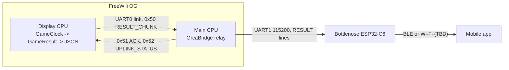
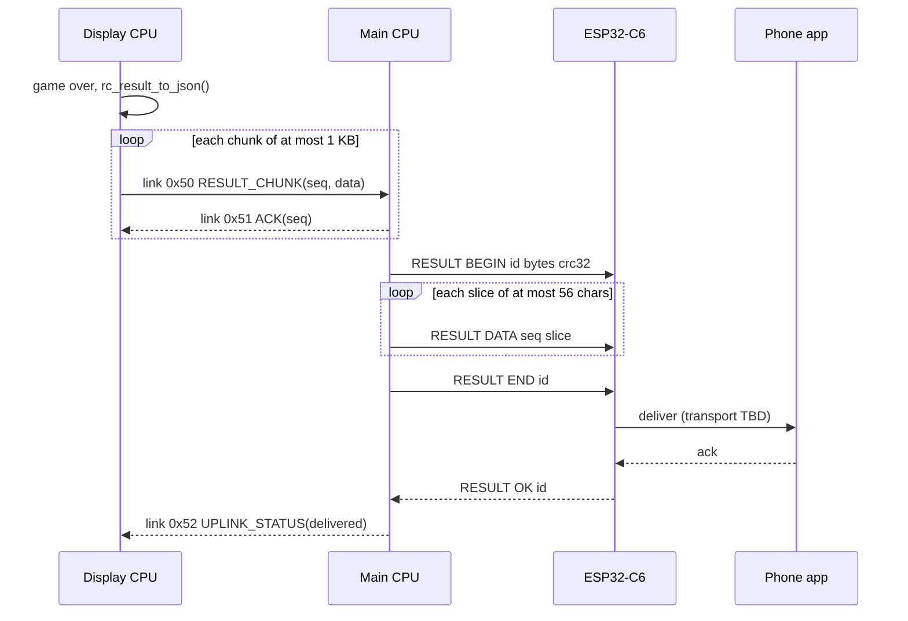

# 04 — Future integration: sending results through the ESP32 to a mobile app

**Status: design only. None of this is in the MVP.** This page fixes two things now so that
neither the firmware nor the mobile app has to guess later:

- **the payload contract** (§2), which the MVP already produces on the USB console when a game
  ends (verification hook, [02](02-mvp.md));
- **where each hop lives** (§1), so the MVP's object model has a place to plug the export in.

Transport details beyond that are deliberately left open.

Requirement covered: R-EXP-1 (send each player's nickname, faction, total time, and an array
of per-turn times after the game) and R-EXP-2 ([01](01-spec-review.md)).

## 1. Data path





### Hop 1: display → main, over the inter-CPU link (UART0)

The link frames are `[0x7E][len16][payload][crc16]` with a payload of at most 4160 B. Payload
byte 0 is the message type, and app types start at 0x40. The bottlenose app uses 0x40/0x41 in
its own image. The proposed types for rootclock:

| Type | Name | Direction | Payload (proposal) |
|---|---|---|---|
| 0x50 | `RC_MSG_RESULT_CHUNK` | display → main | `seq` u8, `last` flag u8, up to 1024 bytes of JSON |
| 0x51 | `RC_MSG_RESULT_ACK` | main → display | `seq` u8 received OK |
| 0x52 | `RC_MSG_UPLINK_STATUS` | main → display | C6 alive, transport connected, last delivery result |

Rules carried over from `apps/bottlenose` and the BSP:

- The display app must call `fwog_link_uart_init(FWOG_LINK_BAUD)` itself, because the
  bootloader leaves the link deinitialised.
- Sends use a timeout, like `bn_link_send()` in `apps/bottlenose/common/bn_link.h`, and never
  the blocking `fwog_link_uart_send_frame()`. RTS/CTS stalls would reset main via its
  watchdog and freeze the display loop.
- Sending is chunked across loop iterations, so `fwog_power_poll()` keeps running and red
  6 s still powers the board off during an export.
- The display passes frames that are not its own to `fwog_ioexp_link_handle()`.

### Hop 2: main → ESP32-C6, over UART1

UART1 is TX on GPIO 8 and RX on GPIO 9, 115200 8N1, with no flow control. The C6 runs the
custom Arduino sketch from `apps/bottlenose/c6/`, which replaces the stock Wet_WILi
firmware; that firmware's protocol is unpublished. The sketch speaks `KEY value\n` lines and
caps inbound lines at **80 characters**, so results go in slices. The compact JSON contains
no spaces or newlines.

| Line | Direction | Meaning |
|---|---|---|
| `RESULT BEGIN <game_id> <bytes> <crc32hex>` | OG → C6 | start of one result |
| `RESULT DATA <seq> <≤56 chars>` | OG → C6 | one slice of the JSON |
| `RESULT END <game_id>` | OG → C6 | complete; the C6 checks length and CRC |
| `RESULT OK <game_id>` | C6 → OG | delivered to the phone |
| `RESULT QUEUED <game_id>` | C6 → OG | stored on the C6, phone not connected yet |
| `RESULT ERR <game_id> <reason>` | C6 → OG | rejected; the OG may retry |

### Hop 3: ESP32-C6 → phone (transport TBD)

| Option | For | Against |
|---|---|---|
| **BLE GATT** (recommended to evaluate first) | Works at the game table with no network; the C6 has BLE 5; the phone connects directly. | Needs pairing and discovery UX in the app; chunked notifications. |
| Wi-Fi HTTP POST | Simple on both ends; proven by the bottlenose demo. | Needs a 2.4 GHz network and a reachable receiver (server, or a phone on the same LAN). |
| C6 soft-AP, phone pulls | No infrastructure. | The phone must switch Wi-Fi networks, which is clumsy on iOS and Android. |

Delivery is **at least once**. The OG retries until `RESULT OK`, so the app must de-duplicate
by `game_id`. The last result stays in display RAM until delivered or until a new game
starts. Persisting it across power-off is post-MVP, like settings persistence.

## 2. Payload contract v1

This is the only definition of the data the phone receives.
[06-mobile-app-starter-spec.md](06-mobile-app-starter-spec.md) copies it verbatim. Any
change bumps `schema_version`.

### Field rules

- All durations are **integer milliseconds**. Paused time is excluded everywhere.
- `players` lists only seats that took at least one turn, in seat order (1–4).
- `turns_ms` is ordered oldest first. If a player has more than 128 turns, the extra time is
  added into the last element and `turns_truncated` is `true`.
- The following hold by construction. A receiver should *warn*, not reject, if they fail:
  - `total_ms == sum(turns_ms)` for each player;
  - `global_ms == sum(players[].total_ms)`.
- `game_id` is an opaque, device-generated string (16 lowercase hex chars, random per game).
  Use it only for identity and de-duplication.
- `ended_at` is ISO 8601 local time without an offset (the OG's RTC has no time zone), or
  `null` when the clock is not known to be set. The MVP always sends `null`.
- `turn_limit_ms` is `null` when the limit is off.
- `nickname` is currently one of `Jacob`, `Alex`, `Ahmed`, `Lorenzo`. `faction` is a key from
  the table below. **Receivers must treat both as open strings:** show unknown values as-is
  and do not reject them.
- Receivers ignore unknown fields. Additive optional fields may appear within v1. Anything
  else is v2.

### Faction keys

The order below is also the firmware's `rc_faction_id_t` order.

| key | short name (device) | full name |
|---|---|---|
| `marquise` | Marquise | Marquise de Cat |
| `eyrie` | Eyrie | Eyrie Dynasties |
| `woodland` | Woodland | Woodland Alliance |
| `vagabond` | Vagabond | Vagabond |
| `riverfolk` | Riverfolk | Riverfolk Company |
| `cult` | Lizard Cult | Lizard Cult |
| `duchy` | Duchy | Underground Duchy |
| `corvid` | Corvids | Corvid Conspiracy |
| `hundreds` | Hundreds | Lord of the Hundreds |
| `keepers` | Keepers | Keepers in Iron |
| `twilight` | Twilight | Twilight Council |
| `knaves` | Knaves | Knaves of the Deepwood |
| `lilypad` | Lilypad | Lilypad Diaspora |

### JSON Schema

```json
{
  "$schema": "https://json-schema.org/draft/2020-12/schema",
  "$id": "rootclock.game_result.v1",
  "title": "rootclock game result, v1",
  "type": "object",
  "required": ["schema", "schema_version", "game_id", "device", "ended_at",
               "turn_limit_ms", "global_ms", "players"],
  "properties": {
    "schema":         { "const": "rootclock.game_result" },
    "schema_version": { "const": 1 },
    "game_id":        { "type": "string", "minLength": 1, "maxLength": 32 },
    "device": {
      "type": "object",
      "required": ["app", "app_version"],
      "properties": {
        "app":         { "const": "rootclock" },
        "app_version": { "type": "string", "pattern": "^[0-9]{3}$" }
      }
    },
    "ended_at":       { "type": ["string", "null"] },
    "turn_limit_ms":  { "type": ["integer", "null"], "minimum": 1 },
    "global_ms":      { "type": "integer", "minimum": 0 },
    "players": {
      "type": "array",
      "minItems": 1,
      "maxItems": 4,
      "items": {
        "type": "object",
        "required": ["seat", "nickname", "faction", "total_ms", "turns_ms",
                     "turns_truncated"],
        "properties": {
          "seat":            { "type": "integer", "minimum": 1, "maximum": 4 },
          "nickname":        { "type": "string", "minLength": 1 },
          "faction":         { "type": "string", "minLength": 1 },
          "total_ms":        { "type": "integer", "minimum": 0 },
          "turns_ms": {
            "type": "array",
            "minItems": 1,
            "maxItems": 128,
            "items": { "type": "integer", "minimum": 0 }
          },
          "turns_truncated": { "type": "boolean" }
        }
      }
    }
  }
}
```

### Example: a 3-player game with a 2:00 limit

The firmware emits this compact, on one line. It is pretty-printed here.

```json
{
  "schema": "rootclock.game_result",
  "schema_version": 1,
  "game_id": "7f3a9c21e04b5d18",
  "device": { "app": "rootclock", "app_version": "001" },
  "ended_at": null,
  "turn_limit_ms": 120000,
  "global_ms": 666000,
  "players": [
    { "seat": 1, "nickname": "Jacob", "faction": "marquise",
      "total_ms": 228000, "turns_ms": [62000, 95000, 71000], "turns_truncated": false },
    { "seat": 2, "nickname": "Alex", "faction": "eyrie",
      "total_ms": 342000, "turns_ms": [88000, 120000, 134000], "turns_truncated": false },
    { "seat": 3, "nickname": "Ahmed", "faction": "woodland",
      "total_ms": 96000, "turns_ms": [45000, 51000], "turns_truncated": false }
  ]
}
```

Size, compact: about 200 B of envelope, about 100 B per player and about 7 B per turn. A
long 4-player game of 30 turns each is about 1.5 KB. The worst case (4 × 128 turns) is about
4.7 KB, which is more than one link frame (4160 B), hence the chunking. That is at most 5 link
chunks and about 85 UART lines, well under 1 s at 115200.

## 3. Firmware work this implies, later

| Where | Work |
|---|---|
| `display/` | `ExportLink`: start after GAME OVER (automatically, or with a button TBD), send chunks without blocking, show the uplink state in the S1 hint row. |
| `common/rc_link.h` | The 0x50–0x52 type numbers and the timeout send, shared by both halves (the bottlenose pattern). |
| `main/` | `OrcaBridge`: a UART1 driver (copy bottlenose's IRQ ring and line assembly), reassemble chunks, emit `RESULT` lines, parse replies, keep `board_watchdog_kick()` in every loop. |
| `c6/` | Extend the bottlenose sketch: buffer `RESULT` lines, check the CRC, deliver over the chosen transport, reply `OK`/`QUEUED`/`ERR`. |
| `core/` | Nothing: `GameResult` and `ResultSerializer` already exist in the MVP. |

## 4. The mobile app (minor details; the starter brief is [06](06-mobile-app-starter-spec.md))

- Receives contract-v1 results, stores them locally and de-duplicates by `game_id`.
- Game list: date, player count, global time.
- Game detail: per player, the nickname, faction, total, and per-turn times as a list or bar
  chart, with the limit line drawn if `turn_limit_ms` is set.
- Per-nickname history across games (the four names make a natural leaderboard).
- Candidate **v2** fields, **not** in v1 and not to be assumed: global turn order, pause
  intervals, `started_at`, board serial, player count chosen at setup.
