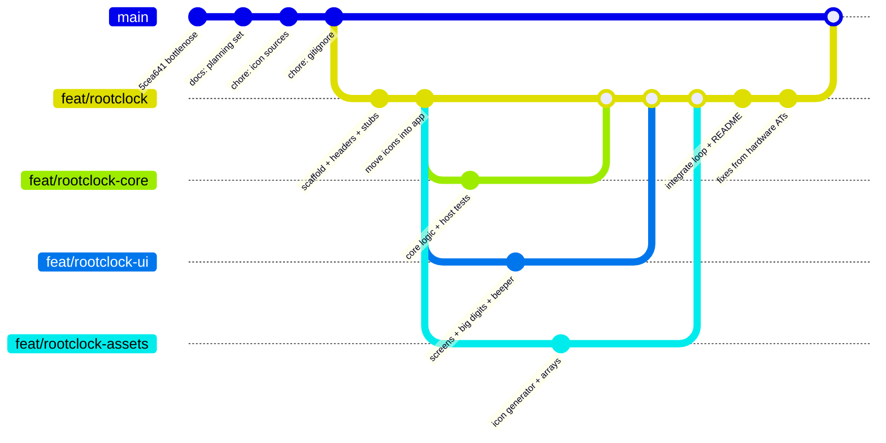

# 05 — Agent implementation plan: building the rootclock MVP

This is the playbook for the Claude Code agent that implements [02-mvp.md](02-mvp.md) in this
repo. It has three goals:

- keep `main` clean and committed before anything new starts;
- do the work on a feature branch;
- split that work across git worktrees, with one subagent per worktree, so the parts can be
  built in parallel without stepping on each other.

Read [01](01-spec-review.md), [02](02-mvp.md) and [03](03-object-model.md) first. The rules in
`CLAUDE.md` and `external/wiliOGbsp/AGENTS.md` apply throughout.

## Run mode: autonomous, in one go

The developer answered every question before the run (2026-11-20). **The run does not stop
to ask.** Where a phase below says what to do on failure, it does that and continues.

| # | Question | Developer's answer |
|---|---|---|
| 1 | Accept every *Assumed* item in [01 §3](01-spec-review.md#3-gaps-and-conflicts-and-how-they-were-resolved)? | **Yes**, they are confirmed. |
| 2 | Flash without asking? | **Yes.** The board is plugged in and dedicated to this run. |
| 3 | Install a host C compiler (MSYS2 gcc)? | **No.** Write the host tests, don't run them, and say so in the commit. |
| 4 | On failure (baseline build, header contract, merge conflict): stop or fix? | **Fix it** and continue. Record what was fixed in the commit message. |
| 5 | End of run? | **Merge to `main` and clean up** worktrees and branches. **Do not push.** |
| 6 | Commit the Root icons and generated arrays? | **Yes.** The repo is private. |
| 7 | Network access (submodule init in each worktree)? | **Allowed.** |
| 8 | Permissions? | The developer runs Claude Code with permission checks **bypassed**, so subagents never stall on a prompt. |

**Hard limits that "fix it" never overrides.** These protect the board, which nobody is
watching. If one of them blocks the run, end with a report and do not work around it.

- Never edit `external/wiliOGbsp/` (the submodule).
- Never copy a display UF2 to any drive, and never flash any way other than `py tools/fw.py`.
- Never open a CPU's serial port at **1200 baud**, which reboots it into BOOTSEL. The test
  harness uses 115200.
- Never hold red, real or injected, for 1 s or more: 6 s powers the board off, and only a
  human can switch it back on. AT-15 is therefore left to the developer.
- Never touch the `battery-app` / `battery-time-to-full` branches, and never push.

## Roles

| Role | Who | Works in | May flash the board? |
|---|---|---|---|
| **Lead** | The main Claude Code session | `C:\Github\hardware-playground` | Yes. The board is dedicated to the run, so no need to ask |
| **core** subagent | general-purpose agent | `C:\Github\hardware-playground-wt\core` | **Never** |
| **ui** subagent | general-purpose agent | `C:\Github\hardware-playground-wt\ui` | **Never** |
| **assets** subagent | general-purpose agent | `C:\Github\hardware-playground-wt\assets` | **Never** |

There is one physical board, so flashing, `fw console` and `fw bootsel` belong to the lead
alone.

## Branches



| Branch | From | Owner | Files it may touch | Gate before merge |
|---|---|---|---|---|
| `main` | — | lead | Phase 0 commits only | Clean `git status`; baseline build green |
| `feat/rootclock` | `main` | lead | Scaffold, headers, stubs, `display/main.c`, app `README.md`, `CMakeLists.txt` of the app, `tools/hw_check.py` | `fw build rootclock` green; `hw_check.py` passes on the board |
| `feat/rootclock-core` | `feat/rootclock` | core | `apps/rootclock/core/*.c`, `apps/rootclock/tests/**` | Builds; host tests pass, or are reported as not run |
| `feat/rootclock-ui` | `feat/rootclock` | ui | `apps/rootclock/display/ui_*.c`, `apps/rootclock/display/beeper.c` | Builds; no full-screen clears in steady state |
| `feat/rootclock-assets` | `feat/rootclock` | assets | `apps/rootclock/tools/gen_faction_icons.py`, `apps/rootclock/display/assets/faction_icons.c` | Builds; re-running the generator produces no diff |

The headers written in Phase 1 are the contract between these branches. That includes
`ui_palette.h`, which the lead writes in full. No subagent edits a `.h` file or
`apps/rootclock/CMakeLists.txt`. The one exception is core, which creates and owns its own
`tests/CMakeLists.txt`. That disjoint ownership is what makes the three merges conflict-free.

---

## Phase 0: secure the current standing on `main` (lead)

Nothing new starts until `main` holds everything that exists today.

1. Confirm the starting point.
   ```
   git switch main
   git status --short
   git log --oneline -3
   ```
   Expect `documents/` and `root icons/` to be untracked. If anything else shows up, read it,
   then commit it as `chore: snapshot work in progress before rootclock`. Never commit
   secrets such as `apps/bottlenose/c6/bottlenose_c6/secrets.h`.
2. Commit the current standing as-is, in separate Conventional Commits:
   - `docs: add rootclock planning documents`, containing `documents/`;
   - `chore: add Root faction icon sources`, containing `root icons/` unchanged. Root art is
     © Leder Games. The repo is private and this run never pushes.
   - `chore: ignore Claude worktrees and local settings`. This appends `.claude/worktrees/`
     and `.claude/settings.local.json` to `.gitignore`.
3. Baseline build, to prove `main` is healthy before branching:
   ```
   py tools/fw.py build bottlenose
   ```
   If it fails, fix it on `main` in its own `fix:` commit, then continue.
4. Do **not** touch the unmerged `battery-app` / `battery-time-to-full` branches. Do **not**
   pull or push.

## Phase 1: feature branch, scaffold and contracts (lead)

1. Create the branch.
   ```
   git switch -c feat/rootclock
   py tools/fw.py new-app rootclock
   ```
   `fw new-app` copies `tools/app_template/`, sets `.fw-app`, and **rewrites the tracked
   `.vscode/tasks.json`**. It runs here once and never in a worktree.
2. Move the icons into the app, without spaces in the names:
   ```
   git mv "root icons/faction-marquise.png" apps/rootclock/assets/factions/marquise.png
   ...one line per faction, keys as in 04 §2...
   git mv "root icons/faction-lord of the hundreds.png" apps/rootclock/assets/factions/hundreds.png
   ```
3. Write the contract headers, with full doc comments, following [03](03-object-model.md):
   - `core/rc_types.h`, `rc_stopwatch.h`, `rc_player.h`, `rc_catalog.h`, `rc_settings.h`,
     `rc_alarm.h`, `rc_input.h`, `rc_game.h`, `rc_result.h`;
   - `display/ui_palette.h` (complete, not a stub), `ui_bigdigits.h`, `ui_clock.h`,
     `ui_settings.h`, `beeper.h`;
   - `display/assets/faction_icons.h`.

   `rc_types.h` fixes `rc_faction_id_t` in the 04 §2 order, `RC_SEATS 4`,
   `RC_MAX_TURNS 128`, `RC_HOLD_MS 2000`, the state and action enums, and
   `rc_buttons_t {down, pressed, released}`, which mirrors `fwog_buttons_t` so that `core/`
   needs no SDK.
4. Add a **stub `.c` for every module** (no-ops returning zeros) and list every source file
   in `apps/rootclock/CMakeLists.txt`. After this, Phase 2 only fills in existing files.
   - `rootclock_display`: `VERSION 001`,
     `DESCRIPTION "rootclock: Root board-game turn clock for 3-4 players"`.
   - `rootclock_main`: the template main, `VERSION 001`.
5. Run `py tools/fw.py build rootclock`. It must be green, and the UF2-info and product-string
   checks run at POST_BUILD.
6. Commit: `feat(rootclock): scaffold app with module headers and stubs`, then
   `chore(rootclock): move faction icons into the app`.

## Phase 2: parallel worktrees and subagents

### Create the worktrees (lead)

Worktrees go in a sibling folder, outside the repo, so that `git status`, VS Code and the
`apps/*` glob never see them.

```
git worktree add -b feat/rootclock-core   ../hardware-playground-wt/core   feat/rootclock
git worktree add -b feat/rootclock-ui     ../hardware-playground-wt/ui     feat/rootclock
git worktree add -b feat/rootclock-assets ../hardware-playground-wt/assets feat/rootclock
git -C ../hardware-playground-wt/core   submodule update --init
git -C ../hardware-playground-wt/ui     submodule update --init
git -C ../hardware-playground-wt/assets submodule update --init
```

- `git worktree add` does not initialise submodules, so without the last three lines both
  `fw` and CMake fail.
- The init needs network access. Offline, add `--reference C:\Github\hardware-playground\external\wiliOGbsp`.
- Each worktree builds into its own `build/`, so expect one cold SDK+BSP build per worktree.

### Spawn the subagents (lead)

Launch the three in **one message**, as background `general-purpose` agents. Every prompt
contains:

- its absolute worktree path and branch. It must use absolute paths or `git -C <wt>`, and
  build with `py <wt>\tools\fw.py build rootclock`;
- its owned files (table above) and the headers it implements against, which it **must not
  edit**;
- the docs to read: 01–03, plus 04 §2 for core and assets;
- the rules below;
- the deliverable: commits on its branch, plus a final report stating what was built, what
  was verified, and what **could not** be verified.

**Rules for every subagent:**

- Build only. **Never** run `fw flash`, `fw run`, `fw console`, `fw bootsel` or `fw new-app`.
- Never edit `external/wiliOGbsp/` (the submodule), any top-level file, any `.h` contract, or
  `apps/rootclock/CMakeLists.txt`. If a contract looks wrong, stop and say so in the report
  instead.
- Never edit files outside the files you own.
- Commit only on your own branch, using Conventional Commits.
- No `printf`: use `DIAG()`. No SDK includes in `core/`.

**core:**

- Implement every `core/*.c` against the headers: the GameClock state machine (doc 3's state
  diagram), stopwatch, turn log with overflow, settings with nickname swap, menu, alarm,
  input mapper with the 2 s hold, result build, and JSON serializer (exactly contract v1).
- Add `apps/rootclock/tests/`, a standalone CMake project with no SDK and `HOST_TEST=1`. It
  reuses `external/wiliOGbsp/tests/test_util.{h,c}` and covers doc 3's seven invariants plus
  every button-map row.
- Check for a host compiler (`where gcc`, then `C:/msys64/mingw64/bin/gcc.exe`). If there is
  none, write the tests anyway and report them as **not run**. Do not install anything.

**ui:**

- Implement `ui_bigdigits.c`: `lcd_font_expand()` into one static 48×64 buffer and
  `st7789_blit()`, redrawing only the glyphs that changed.
- Implement `ui_clock.c` and `ui_settings.c` to doc 2's pixel tables, with caches so that
  steady state redraws only what changed. Use `st7789_rgb565()` for colours.
- Implement `beeper.c`: a ~1 kHz double pip synthesised once into a static 8 kHz buffer,
  `i2s_audio_init(pio0, 2)`, and the bench app's pattern
  (`external/wiliOGbsp/apps/bench/display/main.c`).
- No hardware is available, so report the layout as *unverified on screen*.

**assets:**

- Write `tools/gen_faction_icons.py` (Pillow). For each source icon:
  - crop to the alpha bounding box;
  - fit inside 96×96, keeping the aspect ratio;
  - centre it on a light tile (`#EDE3C8`);
  - convert to RGB565 using the same packing as `st7789_rgb565()`, read from
    `bsp/display_cpu/lcd/st7789.c`;
  - emit `display/assets/faction_icons.c` in `rc_faction_id_t` order, with a `static_assert`
    on the count.
- The output must be deterministic, with no timestamps.
- Also write a contact-sheet PNG of all 13 tiles to the scratchpad (not committed) for the
  lead to show the user.

### Wait

The subagents' completion notifications are what move the work forward. The lead does not
poll their output and does not predict their results.

## Phase 3: integration and hardware acceptance (lead)

1. Merge on `feat/rootclock`, in the main checkout:
   ```
   git switch feat/rootclock
   git merge --no-ff feat/rootclock-core
   git merge --no-ff feat/rootclock-ui
   git merge --no-ff feat/rootclock-assets
   ```
   A conflict means ownership was violated. Resolve it in favour of the owning branch and
   note it in the merge commit. If a subagent reported a header contract problem, the lead
   fixes the header here, after the merges, and adapts the code that uses it.
2. Write `display/main.c`, following the template loop and the BSP rules:
   1. `FWOG_POWER_DEFAULT()`;
   2. `board_init()`, LCD bring-up, `board_backlight(255)`, `ws2812_init(pio0, 0)`,
      `beeper_init()`;
   3. the loop: `fwog_power_poll(now)` → `rc_input_map()` → `rc_game_apply()` →
      `rc_game_tick()` (beep event → `beeper_beep()`) → render S1 or S2 →
      `beeper_process()` → `sleep_ms(2)`.
   4. On GAME OVER, `DIAG()` the result JSON once.
   5. **A test console**, so the agent can drive the board without a human. The display app
      reads lines from its USB stdin (`getchar_timeout_us(0)`, never blocking) and accepts:
      - `press <gray|yellow|green|blue|red>`, a 100 ms tap;
      - `hold <btn> <ms>`, where red is refused at 1000 ms or more;
      - `state`.

      Presses go through `fwog_buttons_inject()`, so they run the real debounce and power
      path. `state` prints one JSON line: state, active/viewed seat, the turn, total and
      global ms, the over-limit flag, and the settings.
3. Write `apps/rootclock/tools/hw_check.py` (pyserial).
   - It finds the display CPU's port by VID:PID **093C:2055** and opens it at **115200**,
     never 1200.
   - It runs AT-01…AT-13 from [02](02-mvp.md) as `press`/`hold`/`state` sequences.
   - It asserts on states, seats, nicknames and factions, on the "global = Σ totals" rule,
     and on elapsed times within ±300 ms tolerance.
   - It captures AT-11's result JSON and checks it against contract v1.
   - It exits non-zero on any failure.
4. Write `apps/rootclock/README.md`: the button map, the AT script and the known limits.
5. Run `py tools/fw.py build rootclock` (the host tests are not run, see decision 3).
6. Flash and check without asking:
   ```
   py tools/fw.py run rootclock
   py apps/rootclock/tools/hw_check.py
   ```
   Fix failures on `feat/rootclock`, rebuild, re-flash, and re-run until it passes. If the
   display port never appears after flashing, re-run `fw run` once. If it still doesn't
   appear, end with a report (hard limits apply).
7. Some checks need eyes or ears, so they go in the final report as **for the developer to
   check**:
   - the layout, the colours and icons, and the red digits;
   - the beep (AT-08);
   - the LED flicker (AT-14);
   - power-off (AT-15).

## Phase 4: land it (lead, as soon as `hw_check.py` passes)

```
git switch main
git merge --no-ff feat/rootclock -m "feat: add rootclock board-game turn clock"
git worktree remove ../hardware-playground-wt/core
git worktree remove ../hardware-playground-wt/ui
git worktree remove ../hardware-playground-wt/assets
git branch -d feat/rootclock-core feat/rootclock-ui feat/rootclock-assets feat/rootclock
```

Do not push. Finish with **one final report** to the developer. It covers:

- the commits on `main`;
- the `hw_check.py` result;
- what was fixed along the way;
- that the host tests were not run;
- the checklist of eyes-and-ears checks from Phase 3 step 7.

## When the run ends early

The run never pauses to ask. It ends early, with that final report, only if a hard limit
(above) would have to be broken. Everything else is handled by the answers in the run-mode
table.

## Commit conventions

- Conventional Commits (`feat:`, `fix:`, `docs:`, `chore:`, `test:`, `refactor:`), scoped
  `(rootclock)` where useful.
- If the host tests could not run, the commit message says so (BSP convention).
- End each message with the attribution trailer the harness specifies.
